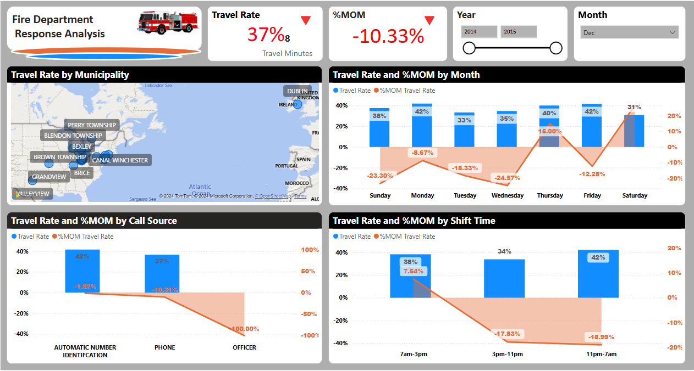
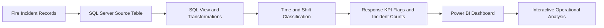
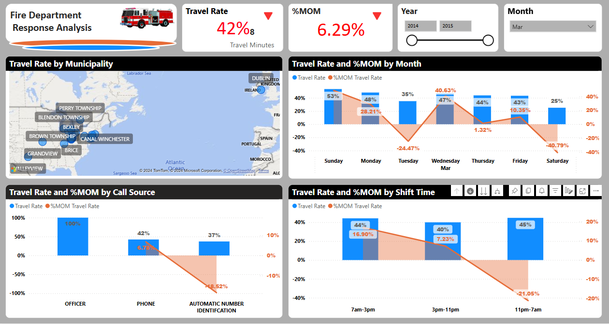

# 🚒 Fire Department Response Analytics | SQL Server & Power BI



## 📑 Table of Contents
- [Project Overview](#-project-overview)
- [Business Problem](#-business-problem)
- [Solution Workflow](#-solution-workflow)
- [Technology Stack](#-technology-stack)
- [Operational KPIs](#-operational-kpis)
- [SQL Data Preparation](#-sql-data-preparation)
- [Dashboard Features](#-dashboard-features)
- [Dashboard Screenshots](#-dashboard-screenshots)
- [Illustrative Findings](#-illustrative-findings)
- [Data Quality and Validation Notes](#-data-quality-and-validation-notes)
- [Project Files](#-project-files)
- [Live Report](#-live-report)
- [Key Learnings](#-key-learnings)

## 🎯 Project Overview

This portfolio project demonstrates how **SQL Server** and **Power BI** can be combined to analyze fire department incident-response performance. SQL transformations derive time-based measures, shift assignments, incident counts, and KPI flags; Power BI provides interactive views by municipality, weekday, call source, and shift.

> **Data note:** The provenance and production status of the underlying incident data have not been established here. Dashboard observations are presented as examples from the project, not verified assessments of any fire department's operations.

## 🚨 Business Problem

Response performance can vary by time of day, call source, and geography. The project explores how analysts could monitor alarm, turnout, travel, and overall response-time thresholds and identify segments worth investigating.

**Questions explored:**
- How does the selected travel-rate measure vary across municipalities?
- How do trends differ by weekday and month?
- Are there differences among the 7 AM–3 PM, 3 PM–11 PM, and 11 PM–7 AM shifts?
- How do officer, phone, and automatic-number-identification call sources compare?

## 🏗️ Solution Workflow



The diagram summarizes the documented analytical workflow; it is not a claim about an automated deployment pipeline.

## ⚙️ Technology Stack

| Technology | Purpose |
|---|---|
| Microsoft SQL Server / T-SQL | Source querying, date calculations, `CASE` logic, window functions, and analytical view |
| Power BI | KPI cards, slicers, combo charts, and geographic visualization |
| SQL views | Reusable dataset logic for downstream reporting |

## 📊 Operational KPIs

The original project describes four threshold-based measures:

| KPI | Intended question | Threshold in supplied SQL |
|---|---|---|
| Alarm time | Was dispatch timely? | ≤ 1 minute |
| Turnout time | Did the unit move promptly after dispatch? | ≤ 1 minute |
| Travel time | Was travel within the target? | ≤ 8 minutes |
| Response time | Was the overall response within target? | ≤ 11 minutes |

**Important:** The original SQL uses `EventFirstDispatched` → `EventFirstEnroute` for the field named `AlarmTime_1Min`, and `Create_Date` → `EventFirstDispatched` for `TurnOutTime_1Min`. These names appear reversed relative to conventional incident-response terminology. Validate the event definitions before treating the KPI labels as authoritative. The travel calculation uses `StartTransport` → `TransportArrive`, which should also be checked against the intended fire-response travel interval.

## 🧮 SQL Data Preparation

### Date attributes and incident counts

The documented SQL uses `DATENAME` and `DATEPART` to derive month and weekday attributes, alongside windowed counts partitioned by calendar periods.

```sql
DATENAME(MONTH, Create_Date) AS Month_,
DATENAME(WEEKDAY, Create_Date) AS DayWeek_,
COUNT(Call_Type) OVER (
    PARTITION BY YEAR(Create_Date), MONTH(Create_Date)
    ORDER BY Create_Date
) AS MTD_Incidents,
COUNT(Call_Type) OVER (
    PARTITION BY YEAR(Create_Date)
    ORDER BY Create_Date
) AS YTD_Incidents
```

**Interpretation:** These window expressions produce running counts across rows ordered by `Create_Date`; their results depend on row granularity, ties, and window-frame behavior. They are not automatically equivalent to a distinct-incident count.

### Shift classification

```sql
CASE
    WHEN DATEPART(HOUR, Create_Date) >= 7
     AND DATEPART(HOUR, Create_Date) < 15 THEN '7am-3pm'
    WHEN DATEPART(HOUR, Create_Date) >= 15
     AND DATEPART(HOUR, Create_Date) < 23 THEN '3pm-11pm'
    ELSE '11pm-7am'
END AS ShiftName
```

### Threshold flags (as documented in the original project)

```sql
CASE WHEN DATEDIFF(MINUTE, EventFirstDispatched, EventFirstEnroute) <= 1
     THEN 1 ELSE 0 END AS AlarmTime_1Min,
CASE WHEN DATEDIFF(MINUTE, Create_Date, EventFirstDispatched) <= 1
     THEN 1 ELSE 0 END AS TurnOutTime_1Min,
CASE WHEN DATEDIFF(MINUTE, StartTransport, TransportArrive) <= 8
     THEN 1 ELSE 0 END AS TravelTime_8Mins,
CASE WHEN DATEDIFF(MINUTE, EventFirstDispatched, EventFirstArrive) <= 11
     THEN 1 ELSE 0 END AS ResponseTime_11Mins
```

The snippets document the original approach rather than a newly tested, production-ready SQL implementation. Before reuse, check null handling, negative intervals, timestamp definitions, and whether `DATEDIFF(MINUTE, ...)` boundary counting matches the business rule.

## ✨ Dashboard Features

- **Travel-rate KPI card** and a separate period-over-period change indicator.
- **Year and month slicers** to narrow the analytical context.
- **Municipality map** for geographic exploration.
- **Weekday comparison** using a combined bar/line view.
- **Call-source comparison** across officer, phone, and automatic-number-identification categories.
- **Shift-level comparison** for three operational shifts.

## 📸 Dashboard Screenshots

### Dashboard — March selection


### Dashboard — December selection



### Project icon


## 💡 Illustrative Findings

In the supplied **March** screenshot, the dashboard displays a **42% travel rate** and **6.29%** in its comparison KPI. The weekday visual displays **53% on Sunday** and **25% on Saturday**. The shift chart displays **44% (7 AM–3 PM)**, **40% (3 PM–11 PM)**, and **45% (11 PM–7 AM)**.

In the supplied **December** screenshot, the headline travel-rate card shows **37%**, and the comparison card shows **−10.33%**. These are different filter contexts, so the two screenshots should not be interpreted as a direct March-to-December comparison without confirming year and measure definitions.

**Potential follow-up analyses:** Validate KPI definitions, investigate weekday and shift variation, compare response patterns across municipalities, and assess whether call-source differences persist after accounting for incident mix and volume.

## 🔎 Data Quality and Validation Notes

Before interpreting results operationally, verify:

1. **Measure definition:** Whether “Travel Rate” means the percentage of records meeting an eight-minute threshold or something else.
2. **Timestamp sequence:** Event creation, dispatch, en route, arrival, and transport timestamps should be mapped to the intended KPIs.
3. **Month-over-month semantics:** Determine whether the comparison is a percentage-point difference or a relative percentage change. A decrease in a threshold-compliance rate would not ordinarily imply faster travel.
4. **Geographic accuracy:** Some map markers appear outside the expected local municipality area, suggesting that place names may need geographic disambiguation.
5. **SQL reproducibility:** The original view includes `SELECT *` alongside grouping and aggregates; the full statement should be reviewed and tested before reuse.

## 📂 Project Files

```text
fire-department-response-analytics/
├── README.md
├── report.png       # March dashboard screenshot
├── problem.png      # December dashboard screenshot
└── fire.png         # Fire department icon
```

This README preserves the SQL excerpts supplied in the original documentation. It does not imply that a runnable database, PBIX file, or complete SQL script is included.

## 🔗 Live Report

[Open the Fire Department Response Analysis report in Power BI](https://app.powerbi.com/reportEmbed?reportId=ec68accf-cd17-4e10-863b-dbed736eda64&autoAuth=true&ctid=78d1fb89-a6cc-4862-a67c-a7287504e26f)

*The link may require Power BI authentication and appropriate access permissions.*

## 💡 Key Learnings

- Applying T-SQL date functions and `CASE` expressions to classify operational records.
- Creating reusable SQL view logic for analytics.
- Exploring running counts and time-based calculations with SQL window functions.
- Designing interactive Power BI views around operational KPIs.
- Distinguishing dashboard observations from validated operational conclusions.
- Recognizing the importance of accurate KPI definitions, event timestamps, and geographic data quality.
